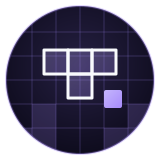
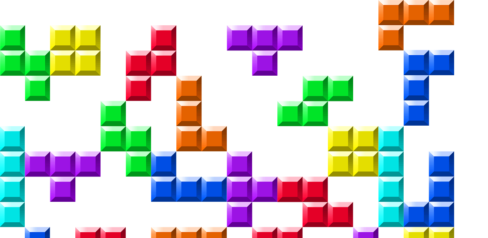

<p align="center">
  
</p>

<h1 align="center">Tetris</h1>

<p align="center">
  <strong>A full-screen Tetris in C++ and SFML, with a menu, a pause and a next-piece queue.</strong><br>
  Ten columns, twenty rows, seven pieces, a level that climbs every two lines and the original
  scoring table.
</p>

<p align="center">
  <a href="#quick-start">Quick start</a> &middot;
  <a href="#how-it-works">How it works</a> &middot;
  <a href="#controls">Controls</a> &middot;
  <a href="#tech-stack">Tech stack</a> &middot;
  <a href="#documentation">Documentation</a>
</p>

<p align="center">
  
  
  
</p>

<p align="center">
  
  <br>
  <sub>The background of the menu, pause and game over screens, drawn under the logo and the two
  buttons.</sub>
</p>

---

Tetris needs very little explanation: pieces fall into a well, full lines disappear, the game ends
when the stack reaches the top. The interesting part of writing one is the structure around that
rule: who owns the grid, who owns the falling piece, how time drives the fall and how the menu,
the pause and the game over share one window.

This repository holds the version written at ETNA as a school project, uploaded to GitHub in March
2022 and not maintained since. It is a small object-oriented C++ program: a `Board` holds the
settled cells and the queue of three upcoming pieces, a `BlockEntity` is the piece in flight, an
`EntityFactory` draws one of the seven shapes at random, and singletons carry the configuration,
the colours, the font, the clock and the current screen. SFML opens the window, draws the squares
and plays the theme in a loop.

## Quick start

**Prerequisites:** `g++`, `make` and the SFML development package with its graphics, window, system
and audio modules (`libsfml-dev` on Debian and Ubuntu). A 1920 by 1080 display: the window opens in
full screen at that resolution.

```sh
git clone https://github.com/verovec/Tetris.git && cd Tetris
make              # builds ./tetris from the .cpp files at the root
./tetris          # run from the repository root: Resources/ is loaded by relative path
```

The menu appears with the music playing. Scroll the mouse wheel to move between **Play** and
**Exit**, press Enter to start. Escape closes the window at any time during a game.

## How it works

```
  Window        SFML, 1920x1080 full screen, 60 frames per second, the theme on loop
     |
  State         GameManager: 0 playing, 1 menu, 2 pause, 3 game over
     |
  Events        wheel and Enter drive the menus; arrows, Z, Space and P drive the piece
     |
  Board         a 10x20 grid of colour indices, the falling piece, three pieces in the queue
     |
  Fall          the piece drops one row every 1/level second, measured by TimeManager
     |
  Lines         full rows are removed, the score grows by 40, 100, 300 or 1200 times the level
     |
  Draw          cells, borders, the next pieces, score and level, or the menu with its buttons
```

Every two lines removed raise the level by one, which both multiplies the score and shortens the
fall delay. A collision on the first row ends the game and switches to the game over screen, from
which a new board can be started.

## Controls

| Key | Where | Action |
|-----|-------|--------|
| Mouse wheel | Menu, pause, game over | Move between the two buttons |
| Enter | Menu, pause, game over | Validate: play, resume, back to menu or exit |
| Left, Right | Game | Move the piece one column |
| Up | Game | Rotate the piece clockwise |
| Z | Game | Rotate the piece counter-clockwise |
| Down | Game | Soft drop, one row and one point |
| Space | Game | Hard drop, two points per row |
| P | Game | Pause |
| Escape | Game | Quit the program |

## Tech stack

| Layer | Tech | Location |
|-------|------|----------|
| Window, drawing, events | SFML graphics, window and system modules | `main.cpp`, `Board.cpp`, `BlockEntity.cpp`, `Menu.cpp` |
| Music | SFML audio, `Resources/sound/Tetris.ogg` on loop | `main.cpp` |
| Game rules | grid, collisions, line removal, scoring, level | `Board.cpp` |
| Pieces | shape matrices, rotation, fall timer | `BlockEntity.cpp`, `EntityFactory.h` |
| Singletons | configuration, colours, font, clock, state | `Config`, `ColorManager`, `ResourceManager`, `TimeManager`, `GameManager` |
| Assets | menu background, logo, buttons, font, theme | `Resources/` |
| Build | Makefile, `g++ -Wall -Werror -Wextra` | `Makefile` |

Details in [Architecture](docs/architecture.md).

## Documentation

| Topic | Where |
|-------|-------|
| Classes, game loop, states, scoring, resources | [`docs/architecture.md`](docs/architecture.md) |
| Build, run, clean up, known limits | [`docs/development.md`](docs/development.md) |
| Everything else | [`docs/`](docs/README.md) |

## Contributing

This repository is kept as is, as an archive of a school project. Issues are still welcome if you
find something worth noting, but no new development is planned.
